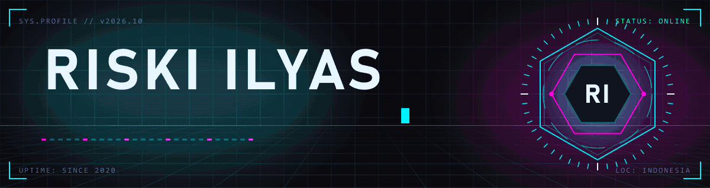
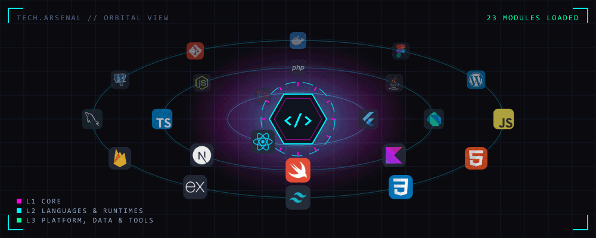

<!-- ═══════════════════════════════════════════════════════════════════════════════
     RISKI ILYAS // PROFILE
     The pictures in assets/ are drawn and animated here: tools/Build-Assets.ps1
     (VectorCraft -> PhotoCraft -> EffectCraft -> gif.mjs). Edit tools/scene.mjs, rebuild.
     ═══════════════════════════════════════════════════════════════════════════════ -->

<div align="center">
  
</div>

<div align="center">
  <a href="https://github.com/riskiilyas">
    
  </a>
</div>

<div align="center">
  
  
  
  
</div>


<!-- ═══════════════════════════════ WHOAMI ═══════════════════════════════ -->

<table border="0" cellspacing="0" cellpadding="0" width="100%">
<tr>
<td width="60%" valign="top">

```bash
┌──(riski㉿cyberdeck)-[~]
└─$ whoami
```

```yaml
name      : Riski Ilyas
role      : Software Engineer
domain    : Mobile & Web Development
primary   : [ Flutter, React, Laravel ]
also      : [ Kotlin, Swift, Next.js, Node, TypeScript ]
os        : [ Windows, Ubuntu, macOS ]
since     : 2020
mission   : turn ideas into robust, production-ready apps
            and keep exploring what is next
status    : 200 OK ✓
```

```bash
┌──(riski㉿cyberdeck)-[~]
└─$ cat motto.txt
"Build things that actually work. Then make them beautiful."
```

</td>
<td width="40%" valign="top" align="center">

<h3>⟨ UPLINK ⟩</h3>

<a href="https://www.linkedin.com/in/riski-ilyas/" target="_blank">
  
</a>
<br/><br/>
<a href="https://medium.com/@riskiilyas03" target="_blank">
  
</a>
<br/><br/>
<a href="mailto:riskiilyas03@gmail.com" target="_blank">
  
</a>
<br/><br/>
<a href="https://github.com/riskiilyas" target="_blank">
  
</a>

<br/><br/>


</td>
</tr>
</table>


<!-- ═══════════════════════════════ TECH ARSENAL ═══════════════════════════════ -->

<h2 align="center">⟨ TECH ARSENAL ⟩</h2>

<div align="center">
  
</div>

<br/>

<table border="0" cellspacing="0" cellpadding="0" width="100%">
<tr>
<td width="33%" valign="top" align="center">

<h3>📱 MOBILE</h3>


```
▸ Flutter   cross-platform, one codebase
▸ Kotlin    native Android
▸ Swift     native iOS
▸ Firebase  auth · push · realtime
```

</td>
<td width="33%" valign="top" align="center">

<h3>🌐 FRONTEND</h3>


```
▸ React       SPA & component systems
▸ Next.js     SSR · routing · SEO
▸ TypeScript  typed, scalable code
▸ Tailwind    fast, consistent UI
```

</td>
<td width="33%" valign="top" align="center">

<h3>⚙️ BACKEND & DATA</h3>


```
▸ Laravel        REST APIs · auth · queues
▸ Node/Express   lightweight services
▸ MySQL/Postgres schema & queries
▸ cPanel/WP      deploy & manage
```

</td>
</tr>
</table>

<div align="center">
  
</div>

<br/>

<div align="center">
  
</div>


<!-- ═══════════════════════════════ TELEMETRY ═══════════════════════════════ -->

<h2 align="center">⟨ SYSTEM TELEMETRY ⟩</h2>

<div align="center">
  
  
</div>

<div align="center">
  
</div>

<br/>

<div align="center">
  
</div>

<br/>

<div align="center">
  
</div>


<!-- ═══════════════════════════════ FOOTER ═══════════════════════════════ -->

<div align="center">

```
╔══════════════════════════════════════════════════════════════╗
║   > connection established · open to collab · let's build ⚡   ║
╚══════════════════════════════════════════════════════════════╝
```

</div>

<div align="center">
  
</div>
